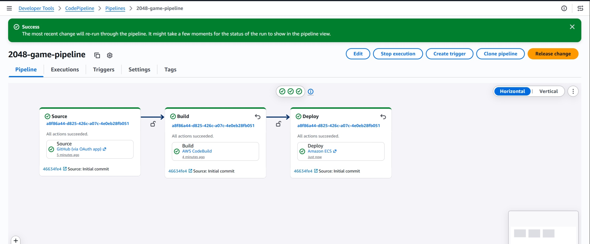
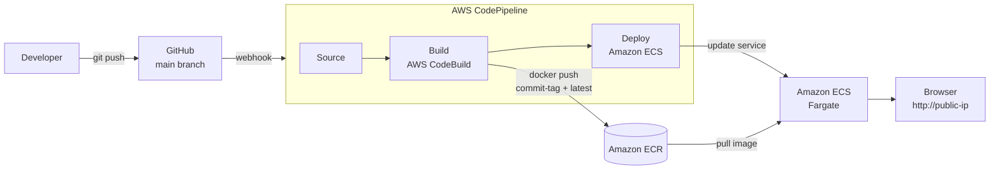

# CI/CD Pipeline for a Dockerised 2048 Game on AWS

An end-to-end CI/CD pipeline that builds a Docker image of the 2048 game, pushes it to Amazon ECR, and deploys it to Amazon ECS (Fargate) — automatically, on every push to `main`.

**Live demo:** push a commit → pipeline runs → new container is live in ~4 minutes, with zero manual steps.



---

## Architecture



**Flow**

1. A commit to `main` triggers CodePipeline via a GitHub webhook.
2. CodeBuild builds the Docker image, tags it with the short commit hash **and** `latest`, pushes both to ECR, and outputs `imagedefinitions.json`.
3. CodePipeline's ECS deploy action reads `imagedefinitions.json` and updates the ECS service. Fargate launches a new task with the new image and drains the old one.

## AWS services used

| Service | Role in this project |
|---|---|
| AWS CodePipeline | Orchestrates Source → Build → Deploy |
| AWS CodeBuild | Builds the Docker image (privileged mode), pushes to ECR |
| Amazon ECR | Private container registry |
| Amazon ECS (Fargate) | Runs the container, serverless — no EC2 to manage |
| Amazon S3 | Stores pipeline artifacts |
| IAM | Service roles for CodeBuild, CodePipeline and the ECS task execution role |
| CloudWatch Logs | Build logs and container logs |

Region: `us-east-1`

## Repository structure

```
.
├── Dockerfile          # nginx:latest + static game files
├── buildspec.yml       # CodeBuild instructions
├── index.html          # Game entry point
├── js/                 # Game logic
├── style/              # CSS
├── meta/               # Icons / manifest
└── docs/screenshots/   # Proof of each stage
```

## Key files

### Dockerfile

```dockerfile
FROM nginx:latest
COPY . /usr/share/nginx/html
EXPOSE 80
CMD ["nginx", "-g", "daemon off;"]
```

A static site served by Nginx. Image size is ~64 MB compressed.

### buildspec.yml

```yaml
version: 0.2

phases:
  pre_build:
    commands:
      - AWS_ACCOUNT_ID=$(aws sts get-caller-identity --query Account --output text)
      - ECR_REGISTRY=$AWS_ACCOUNT_ID.dkr.ecr.$AWS_DEFAULT_REGION.amazonaws.com
      - IMAGE_REPO=$ECR_REGISTRY/2048-game-repo
      - IMAGE_TAG=$(echo $CODEBUILD_RESOLVED_SOURCE_VERSION | cut -c 1-7)
      - aws ecr get-login-password --region $AWS_DEFAULT_REGION | docker login --username AWS --password-stdin $ECR_REGISTRY
  build:
    commands:
      - docker build -t $IMAGE_REPO:$IMAGE_TAG -t $IMAGE_REPO:latest .
  post_build:
    commands:
      - docker push $IMAGE_REPO:$IMAGE_TAG
      - docker push $IMAGE_REPO:latest
      - printf '[{"name":"2048-container","imageUri":"%s"}]' $IMAGE_REPO:$IMAGE_TAG > imagedefinitions.json
artifacts:
  files:
    - imagedefinitions.json
```

Why it is written this way:

- **No hardcoded account ID or region.** Both are resolved at build time, so the file is safe to publish and works in any account.
- **Commit-hash image tags.** Every build produces an immutable tag (e.g. `ec16066`). `imagedefinitions.json` points ECS at that exact tag, so you can always see which commit is running and roll back by redeploying an older tag. `latest` is still pushed for convenience.
- `2048-container` must match the container name in the ECS task definition.

## Improvements over the original tutorial

This project started from a guided lab. These are the changes I made on purpose, and why:

| Change | Reason |
|---|---|
| Fargate task sized at **0.25 vCPU / 0.5 GB** instead of 1 vCPU / 2 GB | A static Nginx site needs very little. Cuts Fargate cost by ~75%. |
| **No task role** on the task definition (execution role only) | The app never calls AWS APIs. Least privilege. |
| Buildspec uses **environment variables**, not hardcoded IDs | Portable and safe to make public. |
| Images tagged with **commit hash + latest** | Traceability and easy rollback. |
| **Removed the broken Test stage** | The lab's Test stage was a second CodeBuild action with no test to run, so it failed and blocked Deploy. Removed until a real smoke test is added. |

## Deployment proof

| Step | Screenshot |
|---|---|
| Docker image built locally | `docs/screenshots/01-docker-build.png` |
| Image pushed to ECR | `docs/screenshots/02-ecr-images.png` |
| ECS cluster and task definition | `docs/screenshots/03-ecs-task-definition.png` |
| CodeBuild succeeded | `docs/screenshots/04-codebuild-success.png` |
| Pipeline all green | `docs/screenshots/05-pipeline-success.png` |
| Pipeline auto-triggered by commit `ec160662` | `docs/screenshots/06-pipeline-auto-trigger.png` |
| Change live in the browser | `docs/screenshots/07-game-live.png` |
| Commit-tagged image in ECR | `docs/screenshots/08-ecr-commit-tag.png` |

## How to reproduce

1. **ECR** — create a private repository `2048-game-repo`.
2. **ECS** — create a Fargate cluster, a task definition (container `2048-container`, port 80, execution role `ecsTaskExecutionRole`, 0.25 vCPU / 0.5 GB), and a service with a public IP and a security group allowing inbound TCP 80.
3. **IAM** — create a CodeBuild service role with ECR push/pull, S3 artifact access and CloudWatch Logs.
4. **CodeBuild** — create a project from this repo, **enable Privileged mode** (required for Docker), use `buildspec.yml`.
5. **CodePipeline** — Source: GitHub (`main`), Build: the CodeBuild project, Deploy: Amazon ECS (cluster + service above).
6. Push a commit and watch it deploy.

## Troubleshooting notes

- **"Cannot connect to the Docker daemon"** in CodeBuild → Privileged mode is off.
- **Pipeline stuck on a failing Test stage** → it was created with no test to run; delete the stage or give it a real buildspec.
- **Public IP changes after each deploy** → expected with Fargate and no load balancer. See next steps.

## Cost and cleanup

Running cost is roughly one Fargate task (0.25 vCPU / 0.5 GB) plus small ECR/S3 storage. To stop charges: set the ECS service desired count to 0, or delete the service, cluster, ECR repository, pipeline and S3 bucket.

## Next improvements

- Application Load Balancer + HTTPS (ACM) so the URL is stable and secure.
- Define all infrastructure in Terraform instead of the console.
- Add a real Test stage (e.g. run the container and `curl` for HTTP 200).
- Blue/green deployment with CodeDeploy.
- Tighten IAM further: replace `*FullAccess` managed policies on the CodeBuild role with scoped policies.
- Move the GitHub source to a GitHub App connection (AWS CodeConnections), the current recommended method.

## Author

**Chathura Dandeniya** — Master of IT (Networking & Cloud Technologies), Deakin University.
Targeting Cloud / DevOps / SRE roles in Australia.

[GitHub](https://github.com/chathura-dandeniya) · [LinkedIn](https://www.linkedin.com/in/YOUR-HANDLE)

Original 2048 game by Gabriele Cirulli (MIT). Lab inspiration: Tech With Lucy.
